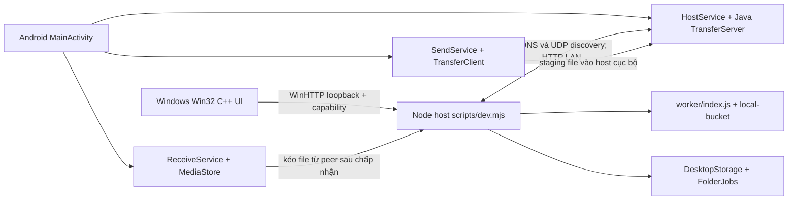

# Kiến trúc thực tế của FlowDrop

Mốc kiểm toán: 11/11/2026, Asia/Saigon. Ưu tiên bảo toàn Windows/Android 1.13.0; iOS tạm dừng. Nhãn bằng chứng: **[SRC]** đã đọc nguồn, **[TEST]** đã chạy kiểm tra trong đợt này, **[DOC]** chỉ là mô tả/báo cáo có sẵn, **[?]** chưa xác minh. Quy ước nguồn đầy đủ ở [báo cáo kiểm toán](AUDIT-REPORT.md).

## 1. Nguồn đang nằm ở đâu

| Vị trí | Đã xác minh | Hệ quả |
| --- | --- | --- |
| `main@2e7708d79e76315f2c8db152b0fa11712e07c037` | [SRC] 31 file: nguồn iOS, workflow iOS và khóa/chứng thư công khai trong `security/`; không có trực tiếp `android/`, `desktop/`, `scripts/`, `tests/` của ứng dụng native | Clone `main` chưa đủ để build Windows/Android |
| Bốn nhánh `automation/flowdrop-release-1.10.0` đến `1.13.0` | [SRC] Mỗi nhánh có `.release/<version>/` chứa bộ cài, Source ZIP, tài liệu, manifest; `.release/publish.py` và workflow upload | Nguồn native tồn tại dưới dạng ZIP, không phải cây mã trực tiếp |
| Asset [FlowDrop-Source-1.13.zip][Z] | [SRC][TEST] 611.206 byte; 141 file dưới `FlowDrop/`; SHA-256 `d1fea853ad992c0b8febf8efa1cc988ef52bc2ca8e6b798eb440f2c7a243a962` | Đây là nguồn native dùng cho kiểm toán này |
| Checkout local lịch sử | [SRC][TEST] 141/141 file ZIP khớp byte với commit local `19435e5dbc3c039446804f3aa7145df6bfc5e13f` | Commit này không phải SHA của `main` trên GitHub; không dựng link GitHub giả cho nó |
| Checkout local đang làm việc | [SRC] HEAD vẫn là commit trên nhưng có thay đổi quản lý khóa chưa commit từ lượt trước | Không dùng các thay đổi đó để mô tả code đã phát hành; đợt kiểm toán không sửa chúng |

Tất cả đường dẫn ký hiệu **Z:** bên dưới là đường dẫn bên trong `FlowDrop/` của Source ZIP, không phải đường dẫn hiện có trên `main`. ZIP khớp nguồn chưa chứng minh APK/EXE được build tái lập từ nguồn đó; chưa rebuild trong giai đoạn 1.

## 2. Thành phần lúc chạy

**[SRC] Windows:** `Z:desktop/windows/FlowDrop.cpp` tạo cửa sổ Win32; dùng WinHTTP gọi Node cục bộ, hộp chọn file/thư mục, drag/drop và cơ chế một instance. `startServer` ở dòng 323–360 chạy Node đi kèm ở nền, lấy cổng/capability qua pipe `FLOWDROP_READY`. Giao diện native không lấy capability qua API HTTP công khai. `Z:desktop/windows/installer.nsi:19–20,38–58` cài theo tài khoản vào `%LOCALAPPDATA%\Programs\FlowDrop`, tạo shortcut và Send To.

**[SRC] Node:** `Z:scripts/dev.mjs:21–36,41–109,118–134` giữ identity, storage, offers, updater và HTTP server; `worker/index.js` thực hiện API transfer trên giao diện bucket; `local-bucket.mjs` ánh xạ bucket sang ổ đĩa. `discovery.mjs` dùng `bonjour-service`; `lan-discovery.mjs` bổ sung UDP trên từng IPv4. Cổng desktop có thể động (`PORT=0` khi native khởi chạy), vì vậy client phải dùng cổng quảng bá.

**[SRC] Android:** `Z:android/src/app/flowdrop/mobile/` chứa Java Activity/Service/Widget và engine HTTP. `HostService.java:82` mở `TransferServer` ưu tiên cổng 5173; server chuyển sang cổng trống khi bị chiếm. `DeviceDiscovery` dùng NSD/Wi-Fi; `LanDiscovery` dùng UDP; `WifiNetwork` chọn mạng Wi-Fi cho kết nối. `SendService` chuẩn bị/stage file trên host cục bộ; `ReceiveService` tải và công bố file qua MediaStore sau khi ghi đủ. `SharedFiles` xử lý chia sẻ `content://` được cấp quyền.

**[SRC] Android manifest:** package `app.flowdrop.mobile`, versionName `1.13.0`, versionCode `14`, minSdk 29, targetSdk 35. Có `SEND`/`SEND_MULTIPLE`, foreground data-sync services, quyền mạng/multicast và cài gói; `allowBackup=false`, cleartext LAN được phép. Các service nhận/gửi/host không exported; Activity nhận chia sẻ được exported.

## 3. Luồng truyền và lưu

1. **[SRC]** Tìm peer bằng mDNS `_flowdrop._tcp` và UDP discovery protocol 1; lấy `/api/config`. Đây là nhận diện theo dữ liệu peer tự khai báo, chưa phải ghép đôi mật mã.
2. **[SRC]** Thiết bị gửi tạo transfer ở chính host của mình, stage từng file theo luồng, rồi gọi `/complete`. Host chỉ công khai metadata/file khi đã `ready`.
3. **[SRC]** Gửi trực tiếp là POST offer sang máy nhận. Máy nhận xác nhận rồi **kéo** file từ máy gửi; máy gửi theo dõi trạng thái được máy nhận xác nhận. Nhận bằng mã là tìm transfer trên các peer được phát hiện, sau đó kéo file tương tự.
4. **[SRC][TEST]** Windows ghi `.part`, kiểm tra số byte rồi công bố file không ghi đè. Android dùng `IS_PENDING` của MediaStore. [TEST] Đã kiểm tra engine Node, host JVM và bộ đọc thư mục; chưa chạy lại Android MediaStore hoặc cửa sổ Windows thật.
5. **[SRC][TEST]** Thư mục được gói ZIP/ZIP64 có MIME riêng. Receiver phục hồi một cây thư mục, giữ thư mục rỗng và nội dung file; root trùng tên được đổi tên để không trộn vào cây có sẵn. ZIP gửi thông thường vẫn là file ZIP.

Chi tiết hợp đồng và phạm vi bảo mật ở [PROTOCOL.md](PROTOCOL.md).

## 4. Dữ liệu và ranh giới

| Dữ liệu | Nơi lưu theo nguồn | Điều phải bảo vệ |
| --- | --- | --- |
| Windows identity/settings/receipts/cache | [SRC] `%LOCALAPPDATA%\FlowDrop\Data` do C++ truyền bằng `FLOWDROP_DATA_DIR`; khi chạy dev dùng `.local-data` hoặc biến môi trường | Không xóa khi cập nhật; capability theo process, không công khai qua discovery |
| File Windows nhận | [SRC] Downloads/FlowDrop mặc định, có thể đổi thư mục trong settings | Không ghi đè; giữ các file đã lưu khi file sau thất bại |
| Android transfer/cache/preferences | [SRC] Bộ nhớ riêng của ứng dụng, SharedPreferences và cache | Không đổi package/khóa ký hoặc coi uninstall là rollback không mất dữ liệu |
| Android file lẻ | [SRC] Ảnh/video vào `DCIM/FlowDrop`; file khác, kể cả SVG, vào `Download/FlowDrop` | Tên có quy tắc làm sạch; chỉ công bố sau khi ghi đủ |
| Android thư mục | [SRC] Nguyên cây vào `Download/FlowDrop/<root>` | Giữ cây và thư mục rỗng; không tách ảnh trong cây sang album |
| Phiên truyền | [SRC] `PeerOffers`/`TransferServer` giữ phiên và trạng thái; Android có `TransferHistory` lưu riêng | Không suy ra lịch sử Windows tồn tại qua restart; chưa xác minh yêu cầu đó |

## 5. Build, phát hành và cập nhật là các lớp khác nhau

- **[SRC]** `Z:scripts/build-installers.py`: Android dùng JDK + aapt2/d8/zipalign/apksigner; Windows dùng MinGW-w64 + NSIS và đóng gói Node. Toolchain và khóa nằm ngoài Source ZIP. Không thấy Gradle project hoặc Electron builder trong nguồn này.
- **[SRC]** `Z:scripts/make-release.mjs` ký raw payload bằng RSA và chuẩn bị gói cập nhật từ bộ cài đã có; không build lại chúng.
- **[SRC]** Workflow `.github/workflows/flowdrop-release-1.13.0.yml` ở nhánh automation chỉ chạy `.release/publish.py`: kiểm tra payload đã chuẩn bị rồi tạo draft/upload/đối chiếu/download lại/publish. Không chạy test ứng dụng hoặc compile native trong workflow này.
- **[SRC][TEST]** Update feed dùng GitHub Releases qua HTTPS, manifest RSA-SHA256 và SHA-256 bộ cài. Android kiểm tra thêm package/version/chứng thư APK. Khóa Ed25519 trên `main/security` ký danh mục khóa công khai, không được updater 1.13.0 sử dụng thay RSA.
- **[?]** Chưa chứng minh build tái lập, nâng/hạ phiên bản trên thiết bị thật, hoặc cơ chế cập nhật hoàn toàn im lặng trên mọi Android. Chi tiết ở [RELEASE-PROCESS.md](RELEASE-PROCESS.md).

## 6. iOS và mã hosted cũ

**[SRC]** `main/ios/` là dự án SwiftUI/FlowDropCore, có workflow thủ công macOS. README `main` còn nói chưa build thành công nhưng có run lịch sử thành công; không dùng README đó làm mô tả kiến trúc Windows/Android. Trong Source ZIP, iOS đã đi tới gói 1.0.3; cây iOS trên `main` không được giả định giống ZIP. Giai đoạn này không sửa hay chạy lại iOS.

**[SRC]** `Z:web/`, `worker/index.js` và `scripts/build.mjs` còn hỗ trợ giao diện/hosted prototype. Node native tái sử dụng handler transfer của worker qua local bucket. Chỉ sự tồn tại của handler hosted không chứng minh hệ thống LAN đang dùng cloud relay. Trang tải/Release không nằm trên đường truyền dữ liệu LAN giữa hai thiết bị.

[Z]: https://github.com/Melbournejr/FlowDrop_IOS/releases/download/v1.13.0/FlowDrop-Source-1.13.zip
