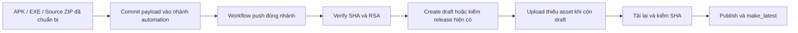

# Quy trình phát hành thực tế và kiểm soát quay lui

Mô tả baseline tại 11/11/2026, Asia/Saigon. **Giai đoạn 1 không chạy build, ký lại, install, dispatch publisher hoặc publish Release.** Các bước build bên dưới là giải thích nguồn hiện có, không phải lệnh được phép thực thi trong PR tài liệu.

## 1. Mốc phục hồi 1.13.0

- Release: [v1.13.0][R]; tag resolve tới `c425078e0de9e70c86c2d3345b2caca7241d0494`, thuộc nhánh automation tương ứng.
- Android: `app.flowdrop.mobile`, versionName `1.13.0`, versionCode `14`, minSdk 29/targetSdk 35 theo manifest trong Source ZIP.
- Nguồn: custom asset `FlowDrop-Source-1.13.zip`, 141 file, khớp commit local `19435e5dbc3c039446804f3aa7145df6bfc5e13f`. Report đi kèm ghi `sourceCommit=7847c97ad9d94911c3e9b44a10ca7023bca7bec2`; đó là commit phát triển trước commit đóng gói, không phải commit release tag trên GitHub.
- Không coi ZIP “Source code” tự động của tag là cây source native đã giải nén. Tag 1.13 chứa payload `.release`, còn tag 1.10/1.11 cùng resolve về commit iOS `ae85b16d9bf4d2f5d365d694b489af9234194099`. Dùng đúng custom Source ZIP đã pin hash.

**[TEST]** Bảy asset trong Git payload khớp `.release/checksums.json` và digest metadata GitHub; custom Source ZIP tải qua GitHub Release khớp lại. Hash APK/EXE local đã đối chiếu thêm với manifest RSA hợp lệ. Chưa rebuild để chứng minh binary reproducibility.

| Asset | Byte | SHA-256 |
| --- | ---: | --- |
| `FlowDrop-1.13.0-Android.apk` | 279316 | `42b6b774153aae6241affd874f63293ace7178665a6c89cf179cefbb66f22d69` |
| `FlowDrop-Setup-1.13.0-Windows-x64.exe` | 24521113 | `576c3aebfc07e82cdf7031d3d607c10cb951f3a348c3e60e2e1393caf4d1349c` |
| `FlowDrop-Source-1.13.zip` | 611206 | `d1fea853ad992c0b8febf8efa1cc988ef52bc2ca8e6b798eb440f2c7a243a962` |
| `latest.json` | 1292 | `344d5e4f46d10a8420a0930352fbb28b2ca4bbe395004f857763af86d76a0e7d` |
| `SHA256SUMS-release.txt` | 198 | `06583b78e8c1f5fc3fadd16309349613f859a1a5090d0ae28fc2e7c0d0496d78` |
| `FlowDrop-Huong-dan-1.13.md` | 11474 | `9f17fe44ff9680cf12e2dbc314baaec5c76b1e2daafe4ad180f15f6f532664e7` |
| `FlowDrop-Kiem-chung-1.13.json` | 2741 | `492a40a628ef4d6c54b61191ba63ceec3ac6ceeb3b8a86145a1050f23c4c26ca` |

RSA trong `latest.json` bao phủ thông tin APK và EXE; không có kết luận nó ký Source ZIP hoặc mọi tài liệu đi kèm. Các asset khác được kiểm SHA với checklist commit và metadata GitHub.

## 2. Build local được mô tả bởi nguồn

Nguồn dưới đây là đường dẫn bên trong [Source ZIP][Z].

| Công đoạn | Thực hiện trong nguồn | Phần phụ thuộc bên ngoài |
| --- | --- | --- |
| Android | `scripts/build-installers.py:15–38`: aapt2 resources → javac Java 8 bytecode → d8 → ZIP → zipalign → apksigner → verify/badging | JDK, Android SDK platform 35, build-tools được đặt tên `android-15`, keystore gốc, fonts |
| Windows | Cùng script, hàm `windows`: copy payload → windres/g++ MinGW-w64 → runtime Node → NSIS | MinGW, NSIS, Node Windows archive/runtime ngoài checkout |
| Update manifest | `scripts/make-release.mjs`: đọc installer đã có trong `artifacts/`, SHA-256, ký raw UTF-8 payload bằng RSA-SHA256, verify bằng public pin | Khóa RSA riêng ngoài source |
| Source ZIP/report | Các asset được chuẩn bị sẵn trước publisher; có trong `.release/1.13.0` | Chưa có workflow compile/test/package native đầy đủ từ một source commit trên main |

Script nhận `--only android`/`--only windows`, lấy tool root từ `FLOWDROP_BUILD_TOOLS`; các lệnh này không chạy trong kiểm toán. Không tự thay toolchain cho khớp README: `desktop/windows/runtime.json` thực tế ghim Node `24.22.2`, trong khi một đoạn README còn ghi `24.15.0`.

Pin runtime từ nguồn: archive SHA-256 `ca1bff5d8ead13c9f2ea404a176db46bd430704d5b5113734049fa365e7799e2`; executable SHA-256 `1c331340fa6cac5e4294725959070a143fa0507195a78ad77eed7943f719aac9`. Build script kiểm executable hash. Việc tải và kiểm archive chính thức được report lịch sử mô tả; đợt này không tải/build lại runtime.

## 3. Ký và identity phải giữ nguyên

**[SRC][TEST] APK:** chứng thư SHA-256 `65cbed4feb375d2c3c2eb94e668bd7aaee7ce5b24f436887873a6fa11719f97f`; RSA 3072 bit. Kiểm tra đọc bằng apksigner trên installer local có hash đúng Release đã đạt (v3, một signer). Tên DN có “FlowDrop Development”; tên đó không chứng minh khóa là Android debug key mặc định hoặc khóa công khai. Không thay signer để sửa cảnh báo cài đặt.

**[SRC] Build ký APK trong ZIP** dùng keystore gốc ngoài repo, alias dự án và mật khẩu ghi cố định trong script. Không lặp lại mật khẩu trong tài liệu/log và không sửa cấu hình này ở giai đoạn 1. Checkout local có thay đổi quản lý khóa chưa commit, không được coi là cấu hình đã phát hành. Chủ dự án phải duyệt riêng việc hoàn thiện migration mật khẩu/storage, giữ nguyên cert.

**[SRC][TEST] RSA updater:** public key ở Node/Android/publisher/`main/security` trùng nhau, modulus 3072 bit; verify manifest thật thành công. Giữ đúng key, thuật toán, payload string và URL feed. Không đưa private key vào Actions chỉ vì Secrets trống.

**[SRC][TEST] Windows:** bảng Certificate Table của EXE phát hành là offset 0/size 0, không có chữ ký Authenticode trong file đã kiểm tra. Chữ ký RSA manifest bảo vệ kênh updater; nó không tạo chứng thư publisher cho Windows Shell. Ed25519 trong `security/` chỉ ký inventory/project, không đổi identity updater.

## 4. Publisher trên GitHub hiện làm gì

Nguồn: [workflow 1.13][W] và [publisher 1.13][P].

- Workflow 1.13 chỉ chạy khi push `automation/flowdrop-release-1.13.0`; dùng `contents:write`, `actions/checkout@v5` và `GITHUB_TOKEN` tạm cho publisher. Không có bước build/test native.
- Publisher assert repo/tag/version/platform URL, check SHA cả 7 asset và verify RSA bằng OpenSSL; Android versionCode phải 14.
- Với release mới, tạo draft trỏ tới `GITHUB_SHA`; chỉ upload khi draft, không ghi đè asset release đã published. Sau upload, tải lại từng asset để check size/hash, rồi publish và đặt latest.
- Publisher 1.10 có kiểm chữ ký/hash nhưng dùng cách kiểm remote khác các bản sau. 1.11/1.12/1.13 có bước tải lại asset. Tag target của 1.10/1.11 khác 1.12/1.13 như mục 1.
- **[TEST metadata]** run 1.13 `42913925358` kết thúc success. Điều này chứng minh workflow publish đã chạy, không chứng minh compile/kiểm thử native đã chạy trong CI.
- **[TEST metadata]** Cả bốn publisher hiện `disabled_manually`. Giai đoạn 1 giữ nguyên trạng thái, không bật lại hoặc dispatch. Workflow iOS vẫn active/manual nhưng iOS đang tạm dừng theo yêu cầu sản phẩm.

## 5. Điều kiện trước một bản mới, cần chủ dự án phê duyệt

1. Chọn một source commit chính thức chứa nguồn native; giữ ZIP/installer/manifest baseline có hash đối chiếu. Chưa import mã native trong PR này.
2. Nêu feature Fxx và test RGxx bị ảnh hưởng; tái hiện lỗi và chạy regression tương ứng, sửa harness riêng khi cần. Không dựa vào report cũ để pass gate mới.
3. Kiểm tra hai chiều/mixed version, dữ liệu lưu, config/history, chức năng share/Send To/folder/update và phần nào chưa có thiết bị thật.
4. Giữ package, cert, key và đường dẫn dữ liệu; nâng version/versionCode khi thực sự phát hành bản mới. Không sửa asset/tag cũ hoặc re-sign baseline.
5. Duyệt rõ phạm vi quyền workflow, môi trường ký, cơ chế giữ khóa, source provenance và cách phát hành draft. PR #1 không tự thêm native build coverage.
6. Chủ dự án quyết định merge và phát hành. Không có bước nào của tài liệu này cấp quyền tự merge/publish.

## 6. Khôi phục và rollback

### Nhánh audit tài liệu

Không merge thì ứng dụng chưa thay đổi. Nếu sau này merge tài liệu và cần quay lại, revert commit tài liệu qua PR; không reset/force push main. Không xóa Release, tag, Source ZIP hay khóa.

### Ứng dụng và dữ liệu

- Giữ nguyên toàn bộ 7 asset 1.13.0, chứng thư/public pins và source có hash. Giữ snapshot settings/receipts/history bằng cách phù hợp từng OS trước thử nâng/hạ; APK `allowBackup=false` nên không mặc định có Android system backup.
- Windows installer cài vào thư mục program riêng, dữ liệu native ở `%LOCALAPPDATA%\FlowDrop\Data`; khả năng chạy lại installer cũ và đọc dữ liệu mới **chưa được chứng minh**. Thử trên tài khoản/máy thử, bảo vệ thư mục file nhận trước thao tác.
- Android OS thường từ chối cài đè APK có versionCode thấp hơn. FlowDrop updater còn từ chối version không mới hơn; thay `latest.json` trỏ về bản cũ không tạo rollback tự động.
- Không đề xuất uninstall rồi cài lại như phương án giữ nguyên dữ liệu. Không thay cert/giảm version check/bỏ verify để ép downgrade.
- Nếu cần quay về logic cũ trong một bản đã nâng, chủ dự án có thể duyệt **forward rollback**: dùng code baseline với version/versionCode mới hơn và cùng signing identity. Đây vẫn là phát hành mới, cần test/protocol/data review và quyền phát hành riêng; không thực hiện ở giai đoạn 1.
- [?] Migration ngược settings/receipt và khôi phục trên điện thoại/Windows thật chưa được kiểm thử. Phải chốt trước khi có bản nâng cấp sản phẩm tiếp theo.

[R]: https://github.com/Melbournejr/FlowDrop_IOS/releases/tag/v1.13.0
[Z]: https://github.com/Melbournejr/FlowDrop_IOS/releases/download/v1.13.0/FlowDrop-Source-1.13.zip
[W]: https://github.com/Melbournejr/FlowDrop_IOS/blob/c425078e0de9e70c86c2d3345b2caca7241d0494/.github/workflows/flowdrop-release-1.13.0.yml
[P]: https://github.com/Melbournejr/FlowDrop_IOS/blob/c425078e0de9e70c86c2d3345b2caca7241d0494/.release/publish.py
